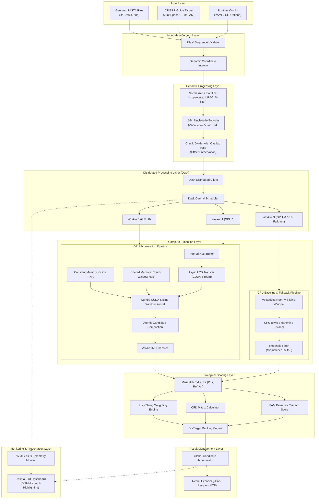
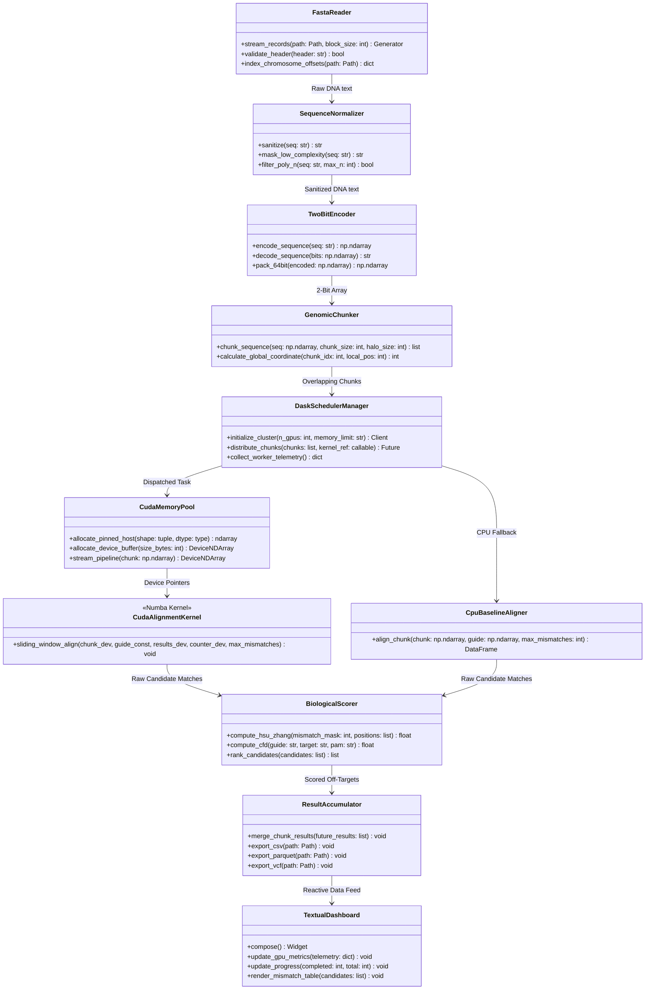

# GeneWeaver: High-Level System Architecture Specification

## 1. Executive Summary & Architectural Vision

**GeneWeaver** is an enterprise-grade, high-performance bioinformatics engine designed to identify CRISPR-Cas9 off-target mutations across whole-genome sequences at scale. Identifying off-target sites is a paramount safety and efficacy challenge in gene editing; standard Cas9 nucleases tolerate multiple mismatches between the single-guide RNA (sgRNA) spacer sequence and genomic DNA, potentially inducing unintended double-strand breaks (DSBs) with mutagenic consequences.

Traditional CPU-bound heuristic aligners (e.g., Bowtie2, BWA-MEM) are optimized for low-divergence sequence mapping rather than exhaustive mismatch enumeration across degenerate motifs. Conversely, exhaustive brute-force CPU search requires days of compute time for mammalian genomes (~3.2 billion base pairs). GeneWeaver addresses this challenge through a **GPU-Accelerated Sequence Alignment Engine**, leveraging massive data-parallel SIMT (Single Instruction, Multiple Threads) processing via **Numba CUDA** and **CuPy**, distributed multi-device orchestration via **Dask**, and responsive real-time operator control via a **Textual** Terminal User Interface (TUI).

```
+--------------------------------------------------------------------------------------------------+
|                                     GENEWEAVER SYSTEM CORE                                       |
|                                                                                                  |
|   +-----------------------+     +------------------------+     +-----------------------------+   |
|   |   INPUT MANAGEMENT    | --> |   GENOMIC PROCESSING   | --> |      DASK ORCHESTRATOR      |   |
|   |  - BioPython Stream   |     |  - 2-Bit Representation|     |  - Cluster Resource Binding |   |
|   |  - Guide & PAM Parse  |     |  - Overlapping Halo    |     |  - Dynamic Chunk Balancing  |   |
|   |  - Input Validation   |     |  - Coord Offset Mapping|     |  - Multi-GPU Task Scheduling|   |
|   +-----------------------+     +------------------------+     +--------------+--------------+   |
|                                                                               |                  |
|                                         +-------------------------------------+                  |
|                                         |                                                        |
|                                         v                                                        |
|   +------------------------------------------------------------------------------------------+   |
|   |                                 EXECUTION & COMPUTE ENGINE                               |   |
|   |                                                                                          |   |
|   |       [GPU Execution Path]                                  [CPU Fallback Path]          |   |
|   |   +--------------------------------------+              +----------------------------+   |
|   |   | Pinned Host Memory (cuda.pinned)     |              | Multithreaded Sliding Win  |   |
|   |   | Asynchronous H2D Transfer (Stream)   |              | Vectorized NumPy Alignment |   |
|   |   | Numba CUDA Sliding Window Kernel     |              | SIMD Coordinate Mapping    |   |
|   |   | Warp Aggregation & Atomic Compaction |              | Bitwise Hamming Distance   |   |
|   |   | Asynchronous D2H Candidate Retrieval |              +-------------+--------------+   |
|   |   +------------------+-------------------+                            |                  |
|   +----------------------|------------------------------------------------|------------------+   |
|                          |                                                |                      |
|                          +-----------------------+------------------------+                      |
|                                                  |                                               |
|                                                  v                                               |
|   +-----------------------+     +------------------------+     +-----------------------------+   |
|   |  BIOLOGICAL SCORING   | --> |   RESULT MANAGEMENT    | --> |       MONITORING & TUI      |   |
|   |  - Hsu-Zhang Weighting|     |  - Global Accumulation |     |  - Textual Terminal UI      |   |
|   |  - CFD Scoring Matrix |     |  - Result Serialization|     |  - Real-time NVML Telemetry |   |
|   |  - PAM Cleavage Factor|     |  - CSV / Parquet / VCF |     |  - DNA Mismatch Highlight   |   |
|   +-----------------------+     +------------------------+     +-----------------------------+   |
+--------------------------------------------------------------------------------------------------+
```

---

## 2. Mandatory Technology Stack & Responsibilities

The GeneWeaver architectural foundation is strictly bound to the mandatory technology stack. The table below delineates the exact system tier, operational responsibilities, and technical justification for each framework:

| Technology | Architectural Tier | Core Operational Responsibilities | Technical Justification |
| :--- | :--- | :--- | :--- |
| **Python (>=3.10)** | Application Runtime | System glue, configuration, high-level orchestration, typing, interfaces | Balances developer velocity with rich scientific C/C++ bindings; widespread adoption in bioinformatics. |
| **BioPython** | Input / Genomic Processing | Streaming FASTA parsing, sequence record validation, IUPAC ambiguity code handling | Standardized, robust genomic parser; prevents bespoke file-parsing bugs on multi-gigabyte FASTA files. |
| **Numba CUDA** | GPU Computation Layer | JIT-compiled custom CUDA kernels, memory transfers, grid/block dimensioning | Direct access to CUDA execution model, shared memory, constant memory, and warp intrinsics without leaving Python. |
| **CuPy** | GPU Computation Layer | GPU-side array allocations, prefix sums, vectorized compaction, CUDA stream handling | Highly optimized CUDA array library with NumPy-identical API; implements zero-copy sharing via `__cuda_array_interface__`. |
| **Dask Distributed** | Distributed Orchestration | Worker cluster management, GPU device binding, task dependency graph, chunk retries | Seamless task scheduling across local multi-GPU workstations or multi-node clusters with fault recovery. |
| **Textual** | Presentation & Monitoring | Async terminal user interface, reactive data widgets, real-time telemetry rendering | High-refresh TUI built on Rich; runs natively over SSH sessions without requiring heavy web servers or browsers. |
| **NumPy** | CPU Baseline & Fallback | Host-side memory layout, 2-bit bitwise transformations, CPU sliding-window baseline | Contiguous C-array memory layout (`ndarray`) compatible with both CPU SIMD vectorization and GPU zero-copy pinning. |
| **Pytest** | Verification & Validation | Automated test discovery, parameterized unit tests, CPU/GPU parity validation | Industry standard for Python testing; supports fixtures for synthetic genomic fixtures and hardware-conditional skips. |

---

## 3. High-Level Architecture Diagram

The high-level architecture diagram illustrates the flow of raw biological inputs, their ingestion and transformation, distributed scheduling across hardware devices, and output presentation:



---

## 4. Detailed Component Architecture Diagram

The detailed component architecture defines the modular boundaries, subsystem interfaces, and data interchange contracts between internal modules:



---

## 5. Layer-by-Layer Architectural Specifications

### A. Input Management Layer
* **Responsibility**: Ingests, validates, and indexes large genomic FASTA files and user-specified sgRNA guides.
* **Input Validation**:
  * Guarantees FASTA compliance (standard NCBI/Ensembl headers, valid ASCII encoding).
  * Validates guide length ($20\text{ nt}$ spacer $+ 3\text{ nt}$ PAM $= 23\text{ nt}$ total for canonical SpCas9).
  * Handles multi-chromosome FASTA headers and unplaced contigs.
  * Rejects corrupted files with actionable error messages; handles `.gz` compressed FASTA transparently.
* **Memory Protection**:
  * Does not load entire chromosomes (e.g. Human Chr1 = 248 MB text) into memory as a monolithic string.
  * Employs streaming block iterators and seeks index offsets.

### B. Genomic Processing Layer
* **Responsibility**: Cleans, encodes, and divides genomic sequences into computationally optimal structures.
* **Sequence Normalization**:
  * Uppercases all nucleotides; translates IUPAC ambiguity codes (`R, Y, S, W, K, M, B, D, H, V`) to masked sentinel values or standard bases with mismatch penalties.
  * Long stretches of undetermined bases (`N` runs $> 20\text{ bp}$) are detected and skipped to conserve GPU cycles.
* **2-Bit Sequence Encoding**:
  * Compresses ASCII characters (`'A'`, `'C'`, `'G'`, `'T'`) into 2-bit binary integer codes ($00_2, 01_2, 10_2, 11_2$).
  * Compresses host RAM footprint by $4\times$ (or $32\times$ if packed into `uint64`).
  * Enables ultra-fast SIMD/SIMT bitwise XOR comparisons.
* **Chunking with Overlap Halo**:
  * Chunks genomic sequences into fixed partitions (e.g., $10\text{ Mbp}$ or $1\text{ Mbp}$ based on GPU VRAM).
  * Enforces an overlap halo of exactly $L - 1 = 22\text{ bp}$ across chunk boundaries to ensure no off-target window straddling two chunks is missed.
  * Embeds absolute genomic coordinate metadata `(chromosome, chunk_id, global_start_idx)` into every chunk descriptor.

### C. GPU Computation Layer
* **Responsibility**: Executes massively parallel DNA sequence alignments using Numba CUDA and CuPy.
* **Kernel & Memory Design**:
  * **CUDA Constant Memory**: Stores the guide RNA (23 bp) and mismatch penalty arrays in the $64\text{ KB}$ constant memory cache, broadcast to all threads with zero latency.
  * **CUDA Shared Memory**: Loads chunk segments into on-chip shared memory per block, with a 22 bp sliding halo to minimize global VRAM memory transactions.
  * **Thread Grid Configuration**: 1D grid of 1D thread blocks (typically 256 threads per block). Each thread slides a 23 bp window over its designated genomic index.
  * **Coalesced VRAM Access**: Sequential threads read sequential contiguous bytes from global memory.
  * **Warp Divergence Elimination**: PAM verification (`NGG` at positions 21–22) occurs first. Non-matching windows exit immediately. Matching windows proceed to bitwise mismatch counting.
  * **Atomic Candidate Compaction**: Matches with mismatches $\le \tau$ (e.g., $\tau \le 4$ or $\le 5$) write their index and bitmask into a global output buffer using `cuda.atomic.add` on a global candidate counter.
* **Pinned Host Transfers & Streams**:
  * Allocates pinned (page-locked) host memory via `cuda.pinned_array` for host buffers.
  * Implements asynchronous double-buffering via CUDA Streams: while Stream A executes kernel computation on Chunk $N$, Stream B asynchronously transfers Chunk $N+1$ from Host to Device (H2D), and Stream C copies results of Chunk $N-1$ from Device to Host (D2H).
* **CPU Fallback**:
  * Detects missing CUDA drivers or incompatible GPUs (`cuda.is_available() == False`).
  * Seamlessly switches to a vectorized NumPy multi-threaded CPU alignment baseline with identical interface and output parity.

### D. Distributed Processing Layer
* **Responsibility**: Scales alignment workloads across multi-GPU or multi-machine environments via Dask Distributed.
* **Cluster Management**:
  * Launches Dask workers with dedicated GPU bindings (via `CUDA_VISIBLE_DEVICES` or `dask_cuda`).
  * Enforces 1 GPU Worker per physical GPU to prevent device resource contention.
* **Dynamic Workload Scheduling**:
  * Distributes genomic chunks dynamically to idle workers, balancing load across heterogeneous GPUs.
  * Monitors worker memory limits to prevent out-of-memory (OOM) fatal crashes.
* **Fault Tolerance & Resilience**:
  * Handles GPU kernel time-outs or worker crashes with automatic task retry policies (configurable retry count, default 3).
  * Aggregates completed futures incrementally using Dask stream listeners.

### E. Biological Scoring Layer
* **Responsibility**: Evaluates the biological likelihood of Cas9 cleavage for candidate sequences.
* **Scoring Algorithms**:
  * **Hsu-Zhang (2013) Score**:
    $$S_{Hsu} = \prod_{i \in M} (1 - W[i]) \times \frac{1}{\frac{19 - d_{avg}}{19} \times 4 + 1} \times \frac{1}{m^2}$$
    where $M$ is the set of mismatch positions, $W[i]$ is the positional weight matrix (heavily penalizing seed region mismatches at positions 1–12), $d_{avg}$ is the mean pairwise distance between consecutive mismatches, and $m$ is the total mismatch count.
  * **CFD (Cutting Frequency Determination) Score (Doench 2016)**:
    Evaluates specific nucleotide mismatch types (e.g. rG:dT vs rC:dA) at each position 1–20 combined with PAM variant scoring factors (`NGG`: 1.0, `NAG`: 0.25, `NGA`: 0.1).
* **Strand Awareness**:
  * Evaluates both Forward (`+`) and Reverse Complement (`-`) genomic strands, preserving biological orientation and coordinate numbering.

### F. Result Management Layer
* **Responsibility**: Aggregates, filters, and exports detected off-target sites.
* **Result Ingestion**:
  * Deduplicates overlapping boundary hits from the chunk halo regions.
  * Sorts candidates globally by biological cleavage score descending.
* **Export Formats**:
  * Structured CSV / TSV with genomic metadata.
  * Apache Parquet for high-speed downstream analytical queries.
  * Standard genomic VCF (Variant Call Format) or BED for integration with IGV (Integrative Genomics Viewer) and UCSC Genome Browser.

### G. Monitoring & TUI Dashboard
* **Responsibility**: Delivers real-time operator observability and interactive inspection via Textual.
* **Telemetry Displays**:
  * Genome ingestion progress (Chunks completed / pending / total).
  * GPU metrics (GPU core utilization percentage, VRAM used/total via NVML).
  * CPU utilization and Host RAM telemetry (via `psutil`).
  * Real-time alignment throughput (Megabases per second, Mbp/s) and estimated time to completion (ETA).
* **Visual Off-Target Inspector**:
  * High-scoring candidate table showing Chromosome, Position, Strand, Mismatches, and Biological Score.
  * **DNA Mismatch Highlighting**: Renders aligned genomic target against sgRNA guide with mismatched base pairs highlighted in bright red Rich markup.

---

## 6. Recommended Directory Structure

To ensure clean separation of concerns and maintainability, the following modular project directory structure is proposed:

```
Gene-Weaver/
|-- .github/
|   `-- workflows/
|       |-- ci.yml                  # Automated Pytest CI workflow
|       `-- gpu_test.yml            # Self-hosted GPU runner test workflow
|-- docs/
|   |-- ARCHITECTURE.md             # This document (High-level architecture)
|   |-- SYSTEM_DESIGN.md            # Low-level systems engineering specification
|   |-- DATA_FLOW.md                # Sequence and data flow specifications
|   `-- COMPONENTS.md               # Detailed module interface specifications
|-- configs/
|   |-- default_config.yaml         # Default runtime parameters (chunk size, threshold)
|   |-- hsu_matrix.json             # Positional weight penalties for Hsu-Zhang scoring
|   `-- cfd_matrices.json           # Nucleotide mismatch matrices for CFD scoring
|-- src/
|   `-- geneweaver/
|       |-- __init__.py             # Package root and version definition
|       |-- genomic_parser/
|       |   |-- __init__.py
|       |   |-- fasta_reader.py     # BioPython FASTA streaming & indexing
|       |   |-- validator.py        # Sequence & guide format verification
|       |   `-- coordinate_indexer.py # Genomic coordinate offset mapping
|       |-- sequence_processor/
|       |   |-- __init__.py
|       |   |-- normalizer.py       # Case conversion, IUPAC resolution, N-masking
|       |   |-- encoder.py          # 2-bit binary nucleotide encoding/packing
|       |   `-- chunker.py          # Halo-partitioned genomic chunk generator
|       |-- alignment/
|       |   |-- __init__.py
|       |   |-- base.py             # Abstract base class / Protocol for aligners
|       |   |-- cpu_aligner.py      # Vectorized NumPy CPU baseline & fallback
|       |   `-- reverse_complement.py # Reverse complement strand generator
|       |-- cuda_engine/
|       |   |-- __init__.py
|       |   |-- device_manager.py   # GPU device detection, capabilities, context
|       |   |-- memory_pool.py      # Pinned host memory & CuPy buffer allocator
|       |   |-- stream_pipeline.py  # Asynchronous multi-stream execution pipeline
|       |   |-- kernels.py          # Numba CUDA sliding-window alignment kernels
|       |   `-- cupy_ops.py         # CuPy array transformations & compaction
|       |-- distributed_scheduler/
|       |   |-- __init__.py
|       |   |-- cluster_manager.py  # Dask client & worker initialization
|       |   |-- gpu_worker.py       # GPU device-pinned Dask worker wrapper
|       |   |-- task_graph.py       # Dask delayed graph generation
|       |   `-- aggregator.py       # Distributed future collector & error handler
|       |-- scoring/
|       |   |-- __init__.py
|       |   |-- pam_evaluator.py    # Canonical/non-canonical PAM validator
|       |   |-- hsu_zhang.py        # Hsu-Zhang 2013 scoring algorithm
|       |   |-- cfd_score.py        # Doench 2016 Cutting Frequency Determination
|       |   `-- ranker.py           # Multi-criteria candidate ranking engine
|       |-- result_manager/
|       |   |-- __init__.py
|       |   |-- accumulator.py      # Thread-safe global off-target accumulator
|       |   |-- deduplicator.py     # Halo boundary overlap deduplication
|       |   `-- exporter.py         # CSV, Parquet, VCF, and JSON serialization
|       |-- monitoring/
|       |   |-- __init__.py
|       |   |-- telemetry.py        # NVML GPU stats & psutil CPU collector
|       |   `-- events.py           # Internal event bus & progress emitters
|       |-- dashboard/
|       |   |-- __init__.py
|       |   |-- app.py              # Textual TUI Application entrypoint
|       |   |-- widgets/
|       |   |   |-- __init__.py
|       |   |   |-- gpu_meter.py    # Reactive GPU utilization & VRAM gauge
|       |   |   |-- progress_bar.py # Genomic chunk processing progress widget
|       |   |   |-- mismatch_table.py # Colored DNA mismatch alignment table
|       |   |   `-- log_panel.py    # Diagnostic system log & error console
|       |   `-- styles.tcss         # Textual CSS styling definitions
|       `-- configuration/
|           |-- __init__.py
|           |-- settings.py         # Pydantic v2 application settings model
|           `-- hardware_detect.py  # CUDA runtime & hardware capability detector
|-- tests/
|   |-- __init__.py
|   |-- conftest.py                 # Pytest fixtures (synthetic FASTA, mock guides)
|   |-- unit/
|   |   |-- test_fasta_reader.py
|   |   |-- test_encoder.py
|   |   |-- test_chunker.py
|   |   |-- test_scoring.py
|   |   `-- test_cpu_aligner.py
|   |-- integration/
|   |   |-- test_cuda_pipeline.py   # GPU pipeline test (marked with @pytest.mark.cuda)
|   |   |-- test_dask_cluster.py    # Dask distributed test
|   |   `-- test_parity.py          # Exact parity test: CPU output == GPU output
|   `-- benchmarks/
|       |-- test_cpu_vs_gpu.py      # Automated speedup validation benchmark
|       `-- test_memory_profile.py  # VRAM peak allocation stress test
|-- benchmarks/
|   |-- synthetic_generator.py      # Generates synthetic genomes with known off-targets
|   `-- profile_runner.py           # CLI benchmark driver for speedup reports
|-- pyproject.toml                  # Modern Python packaging & build configuration
|-- README.md                       # Repository overview & setup guide
`-- LICENSE                         # Project license
```

---

## 7. Architectural Decision Records (ADRs)

### ADR-01: Adoption of Numba CUDA over Pure C++/CUDA PyBind11
* **Context**: GeneWeaver requires custom CUDA sliding-window kernels for Hamming distance and PAM evaluation.
* **Decision**: Adopt **Numba CUDA** for JIT kernel generation.
* **Rationale**: Numba compiles decorated Python functions directly to PTX and native machine code via the LLVM CUDA backend. It allows seamless inline kernel definitions, eliminates external C++ build chains (CMake, MSVC), and simplifies distribution while maintaining near-identical GPU execution performance.
* **Trade-off**: Slightly higher first-call latency due to JIT compilation (mitigated via pre-compilation during startup).

### ADR-02: 2-Bit Binary Nucleotide Encoding over Raw ASCII
* **Context**: DNA consists of 4 standard nucleotides (`A`, `C`, `G`, `T`). Raw ASCII requires $1\text{ byte}$ ($8\text{ bits}$) per nucleotide.
* **Decision**: Convert sequences into a 2-bit encoded format ($A=00_2, C=01_2, G=10_2, T=11_2$).
* **Rationale**:
  * Reduces raw genomic memory footprint by $75\%$ (e.g. $3.2\text{ GB} \rightarrow 800\text{ MB}$).
  * Fits inside contiguous byte arrays or packed `uint64` integers (32 nucleotides per 64-bit word).
  * Enables fast parallel bitwise comparison: a bitwise XOR reveals mismatches instantaneously.

### ADR-03: Asynchronous Double-Buffering with CUDA Streams
* **Context**: Naive GPU execution stalls the GPU during Host-to-Device (H2D) memory copies and Device-to-Host (D2H) result transfers over PCIe.
* **Decision**: Implement a triple-stream asynchronous pipeline utilizing pinned (page-locked) host memory.
* **Rationale**: Concurrently overlaps kernel execution of chunk $N$ with PCIe transfer of chunk $N+1$ and result retrieval of chunk $N-1$, saturating GPU compute units and maximizing PCIe bandwidth.

### ADR-04: Dask Distributed Cluster for Multi-GPU Scheduling
* **Context**: Multi-GPU workstations require explicit device assignment and workload balancing without deadlocks.
* **Decision**: Utilize **Dask Distributed** with `dask_cuda` worker bindings.
* **Rationale**: Dask provides dynamic task graph scheduling, native CUDA memory spill management, automatic task retry upon worker failure, and seamless scaling from 1 GPU to multi-GPU clusters.

### ADR-05: Textual Async TUI over Web/Electron Interfaces
* **Context**: Bioinformaticians predominantly operate on headless remote HPC clusters via SSH.
* **Decision**: Utilize **Textual** for the monitoring and visualization dashboard.
* **Rationale**: Textual runs natively in terminal emulators over SSH with zero network port forwarding, zero browser dependencies, and minimal CPU overhead, while providing rich, reactive UI widgets.

---

## 8. Hardware Compatibility & Deployment Matrix

| Hardware Tier | Minimum Spec | Recommended Spec | Enterprise / HPC Spec |
| :--- | :--- | :--- | :--- |
| **GPU Architecture** | NVIDIA Pascal (GTX 1080, CC 6.1) | NVIDIA Ampere / Ada (RTX 3080/4090, CC 8.6/8.9) | NVIDIA Hopper / Blackwell (H100/B200, CC 9.0+) |
| **GPU VRAM** | 6 GB VRAM | 16–24 GB VRAM | 80 GB HBM3 |
| **CUDA Toolkit** | CUDA 11.8 | CUDA 12.2+ | CUDA 12.4+ |
| **Host CPU** | 4 Cores x86_64 | 16 Cores x86_64 / ARM64 (Neoverse) | 64+ Cores (AMD EPYC / Intel Xeon) |
| **Host System RAM** | 16 GB DDR4 | 32–64 GB DDR4/DDR5 | 256+ GB ECC DDR5 |
| **Storage** | SATA SSD | NVMe SSD (Gen4, >5000 MB/s read) | Distributed NVMe-oF / Lustre / GPFS |
| **OS Support** | Ubuntu 20.04 LTS / WSL2 | Ubuntu 22.04 LTS / Rocky Linux 9 | Red Hat Enterprise Linux 9 / SLES 15 |
| **CPU Fallback** | Supported (NumPy SIMD) | Supported (NumPy SIMD) | Supported (NumPy SIMD) |
