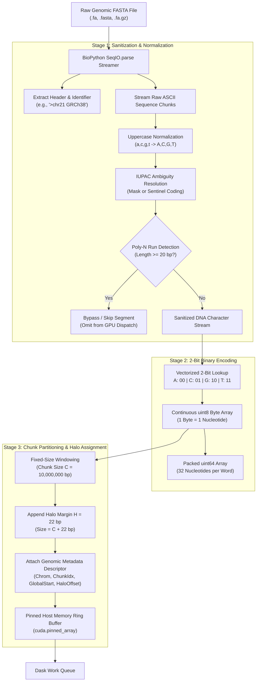
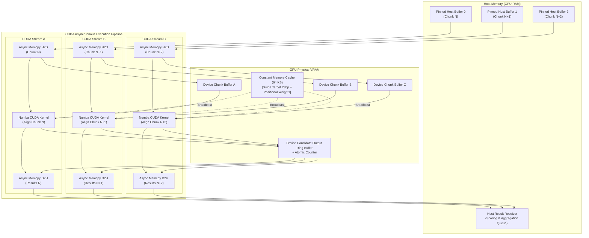
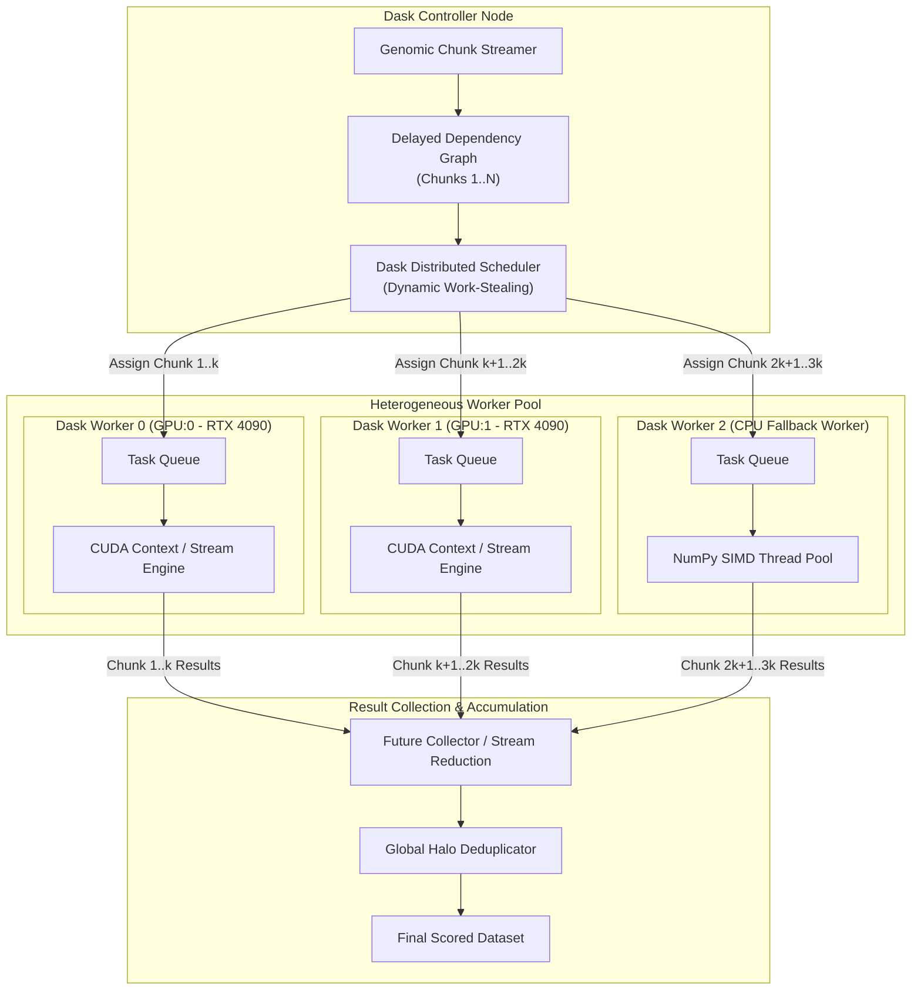
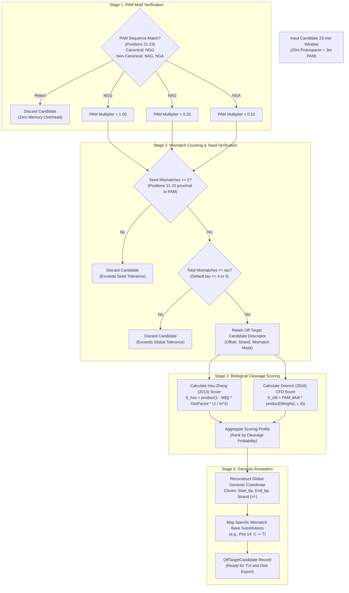

# GeneWeaver: End-to-End Data Flow & Pipeline Architecture

## 1. End-to-End Sequence Alignment Data Flow

The end-to-end data flow traces the transformation of raw biological data from external storage through memory buffers, CUDA compute devices, distributed workers, biological scoring, and interactive presentation.

```mermaid
sequenceDiagram
    autonumber
    actor User as Operator / Bioinformatician
    participant TUI as Textual Dashboard
    participant Reader as BioPython FASTA Streamer
    participant Proc as 2-Bit Encoder & Chunker
    participant Dask as Dask Scheduler
    participant Worker as GPU Worker (CUDA)
    participant Scorer as Biological Scoring Engine
    participant Acc as Result Accumulator & Exporter

    User->>TUI: Launch GeneWeaver(FASTA_path, Guide_sequence, Options)
    TUI->>Reader: Initiate Stream Request
    loop For Each Chromosome / Contig
        Reader->>Proc: Stream FASTA Record (String Slices)
        Proc->>Proc: Normalize (Uppercase, IUPAC, N-Filter)
        Proc->>Proc: 2-Bit Encode & Partition Chunks (22bp Halo Overlap)
        Proc->>Dask: Submit Delayed Chunk Task(Chunk_Descriptor, Guide_Bits)
    end
    
    Dask->>Worker: Dispatch Chunk Task to Available GPU Worker
    Worker->>Worker: Allocate Pinned Host Buffer & Async H2D Transfer
    Worker->>Worker: Launch Numba CUDA Sliding-Window Kernel
    Worker->>Worker: Staged Evaluation: PAM Check -> Seed Check -> Distal Check
    Worker->>Worker: Atomic Compaction of Matches (Mismatches <= tau)
    Worker->>Worker: Async D2H Result Transfer to Host
    Worker-->>Dask: Return Raw Candidate Array
    
    Dask-->>Scorer: Stream Raw Candidates (Coordinates, Mismatch Mask)
    Scorer->>Scorer: Extract Exact Base Substitutions
    Scorer->>Scorer: Calculate Hsu-Zhang (2013) Score
    Scorer->>Scorer: Calculate Doench (2016) CFD Score
    Scorer->>Scorer: Evaluate PAM Cleavage Multiplier
    Scorer-->>Acc: Stream Enriched Off-Target Records
    
    Acc->>Acc: Deduplicate Halo Boundary Overlaps
    Acc->>Acc: Update Sorted In-Memory Result Index
    Acc-->>TUI: Post Candidate Event to TUI Reactive Bus
    TUI->>TUI: Render Mismatch Table (Red Highlights) & Telemetry
    
    User->>TUI: Trigger Export Command
    TUI->>Acc: Request Serialization(CSV / Parquet / VCF)
    Acc-->>User: Write Structured Files to Disk
```



---

## 2. Genomic Data Processing Workflow

The diagram below illustrates the exact transformations applied to genomic sequence data before submission to compute devices:



---

## 3. GPU Execution & Memory Transfer Workflow

The GPU pipeline utilizes triple-buffering across CUDA Streams to ensure that Host-to-Device transfer, compute kernel execution, and Device-to-Host result collection run fully concurrently:



---

## 4. Dask Distributed Processing Architecture

GeneWeaver orchestrates parallel genomic chunks across available GPUs and CPU fallbacks using a dynamic Dask task graph:



---

## 5. Off-Target Detection & Scoring Workflow

The diagram below details the hierarchical filtering and scoring stages applied to identify and rank candidate off-targets:



---

## 6. Data Ingestion & Transformation Lifecycle

The table below outlines the precise data transformation pipeline across each tier of the system:

| Pipeline Step | Input Data Representation | Processing Entity | Output Data Representation | Memory Domain |
| :--- | :--- | :--- | :--- | :--- |
| **1. File Ingestion** | Plain text FASTA (`.fa` / `.fa.gz`) | BioPython `SeqIO.parse` | In-memory Python `SeqRecord` slices | Host OS Buffer $\rightarrow$ Python Heap |
| **2. Sanitization** | Raw ASCII sequence string | `SequenceNormalizer` | Uppercased string, `N`-masked | Python Heap |
| **3. Encoding** | Sanitized ASCII string | `TwoBitEncoder` | 1D `numpy.ndarray` (`uint8` / packed `uint64`) | Host Pageable RAM |
| **4. Chunking & Halo** | Contiguous 2-bit array | `GenomicChunker` | Chunk descriptors with $22\text{ bp}$ halo margin | Pinned Host RAM (`cuda.pinned_array`) |
| **5. H2D Transfer** | Pinned Host Buffer | CUDA Stream `cuda.memcpy_async` | Device VRAM array pointer | GPU Global VRAM |
| **6. Kernel Alignment** | Device sequence buffer + Constant guide | Numba CUDA sliding kernel | Candidate integer descriptors `(idx, strand, mask)` | GPU Shared $\rightarrow$ Global VRAM |
| **7. D2H Transfer** | Device candidate buffer | CUDA Stream `cuda.memcpy_async` | Host NumPy array of candidate hits | GPU VRAM $\rightarrow$ Pinned Host RAM |
| **8. Scoring** | Candidate integer descriptors | `BiologicalScorer` | Typed `OffTargetCandidate` dataclass records | Python Heap |
| **9. TUI Display** | Typed candidate records | Textual TUI Widget | Colored Rich Text Markup (Red Mismatches) | Terminal Emulator Video Buffer |
| **10. Export** | Aggregated candidate records | `ResultExporter` | CSV, Parquet, or VCF files | Disk Storage (NVMe) |

---

## 7. State Transition Lifecycle of a Genomic Chunk

A single genomic chunk progresses through a strict, deterministic state machine:

```
[PENDING]
    |
    v (Submitted to Dask Task Graph)
[QUEUED]
    |
    v (Assigned to GPU Worker; Memory Pinned)
[IN_TRANSFER_H2D]
    |
    v (VRAM Populated; Stream Kernel Launched)
[IN_KERNEL_COMPUTE]
    |
    v (Kernel Exited; Atomic Compaction Complete)
[IN_TRANSFER_D2H]
    |
    v (Host Buffer Populated)
[BIOLOGICAL_SCORING]
    |
    v (Hsu-Zhang & CFD Calculated; Halo Deduplicated)
[AGGREGATED]
```

### State Error Handling & Recovery Rules
1. **Host-to-Device Transfer Timeout**: If PCIe transfer fails or stalls $> 10\text{ s}$, the worker resets the CUDA stream and restarts transfer.
2. **CUDA Kernel Error (Illegal Memory Access / Hardware Fault)**:
   * The Dask worker intercepts the `CudaSupportError`.
   * The worker context is destroyed and recreated.
   * The chunk transitions back to `QUEUED` with an incremented retry counter.
   * If retries exceed 3, the chunk falls back to the CPU worker.
3. **Out-of-Memory (VRAM OOM)**:
   * Dynamic chunk subdivider halves the chunk size ($10\text{ Mbp} \rightarrow 5\text{ Mbp}$) and resubmits the sub-chunks to `QUEUED`.
