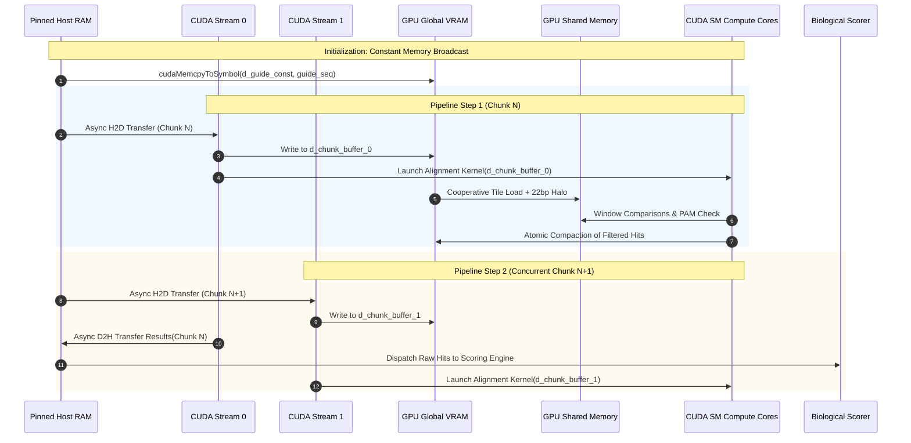
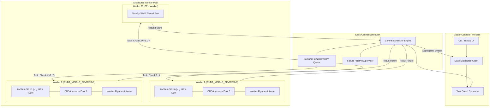
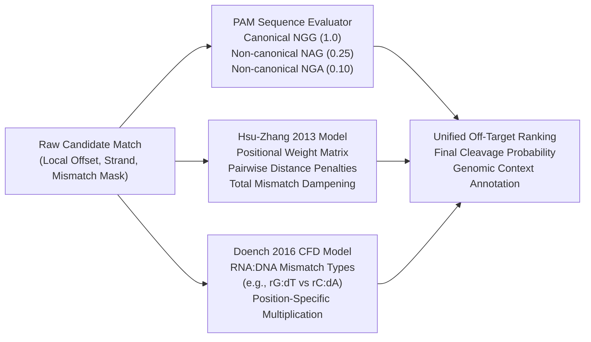

# GeneWeaver: System Engineering & Component Design

## 1. System Engineering Overview

The **GeneWeaver** system engineering architecture bridges biological sequence algorithms with hardware-accelerated parallel architectures. Designing a whole-genome off-target search engine requires solving four fundamental engineering bottlenecks:

1. **I/O & Memory Bottleneck**: Whole genomes (e.g., Human GRCh38 = ~3.2 Gbp) cannot be naively loaded or duplicated across CPU and GPU memory without causing Out-Of-Memory (OOM) thrashing.
2. **Bandwidth Bottleneck (PCIe Host-to-Device)**: Memory transfer over PCIe Gen3/Gen4 (16–32 GB/s) can easily dominate compute time if data transfers are not hidden behind asynchronous execution streams.
3. **Branch Divergence & Memory Divergence in CUDA**: Sliding a $23\text{ bp}$ window over billions of genomic positions introduces warp divergence if threads take branches based on mismatch counts, or non-coalesced memory reads if threads access misaligned global memory.
4. **Distributed GPU Heterogeneity**: Multi-GPU environments need non-blocking task distribution, dynamic load balancing, and failure isolation to sustain 100% device saturation.

This document details the engineering specifications, memory hierarchies, mathematical scoring models, and execution mechanics that resolve these challenges.

---

## 2. Input Management & FASTA Streaming Architecture

### 2.1 File Ingestion & Format Validation
Bioinformatic FASTA files contain multi-line plain text records initiated by a header line (`>chromosome_identifier [metadata]`). In standard mammalian reference genomes (e.g., `Homo_sapiens.GRCh38.dna.primary_assembly.fa`), chromosome records vary widely from Chromosome 1 (~248 Mbp) to small unplaced scaffolds (~10 kbp).

The **Input Management Layer** enforces strict validation invariants:
- **Header Parsing**: Extracts chromosome/contig identifiers via regular expressions matching NCBI/Ensembl standards (`^>([a-zA-Z0-9_\.]+)`).
- **Guide RNA Verification**: The user-provided guide must conform to standard IUPAC DNA alphabet (`A, C, G, T`) with a total length of $23\text{ bp}$ for standard SpCas9 ($20\text{ nt}$ spacer $+ 3\text{ nt}$ PAM). Guide inputs specified as RNA (`U`) are automatically converted to DNA (`T`).
- **File Integrity & Compression**: Employs Python `gzip` stream wrappers when `.gz` magic bytes (`0x1F 0x8B`) are detected, eliminating pre-decompression disk bloat.

### 2.2 Memory Footprint Control & Chunk Streaming
To maintain a strict host memory footprint ($\le 2\text{ GB}$ peak RSS regardless of genome size), sequences are ingested using BioPython's `SeqIO.parse` combined with an indexed seek table:

```
[FASTA File on NVMe/SSD]
       |
       v (Buffered Stream Reader: 64 KB OS Buffers)
[BioPython SeqIO Chunk Streamer]
       |
       v (Generator yielding 10 Mbp slices)
[Sequence Normalizer & 2-Bit Encoder]
       |
       v (Pinned Host Memory Ring Buffer)
[Dask Task Scheduler]
```

---

## 3. Genomic Coordinate System & Overlapping Halo Partitioning

### 3.1 The Sliding Window Boundary Problem
When sliding a window of length $L = 23\text{ bp}$ (20 nt protospacer + 3 nt PAM) across genomic sequences divided into fixed-size chunks of length $C$ (e.g., $C = 10,000,000\text{ bp}$), any candidate sequence that straddles the boundary between Chunk $K$ and Chunk $K+1$ will be truncated and missed if chunks are strictly disjoint.

```
Chunk K:   [ ... A  T  G  C  A  T  C  G ] (End of Chunk K)
Chunk K+1: [ G  A  C  T  G  A  A  T ... ] (Start of Chunk K+1)
Boundary Window:        [ C  G | G  A  C  T  G  A  A  T  C  G  T  A  G  C  C  T  G  A  T  G  G ]
                         <----- 23 bp candidate window straddling boundary ----->
```

### 3.2 Overlap Halo Specification
To guarantee 100% mathematical sensitivity with zero boundary loss:
- Every chunk of nominal size $C$ is extracted with a trailing **Halo Margin** of exactly $H = L - 1 = 22\text{ bp}$.
- **Chunk Extraction Formula**:
  $$\text{Start}_{K} = K \times C$$
  $$\text{End}_{K} = \min(\text{Start}_{K} + C + H, N_{chrom})$$
- **Global Coordinate Tracking**:
  Each chunk carries a coordinate descriptor tuple:
  $$\text{Descriptor} = (\text{chrom\_id}, \text{chunk\_idx}, \text{global\_start\_bp}, \text{halo\_offset})$$
  When a candidate is detected at local chunk offset $i$, its true 1-based genomic coordinate is reconstructed via:
  $$\text{Genomic\_Pos} = \text{global\_start\_bp} + i + 1$$
- **Deduplication Invariant**:
  If a candidate begins at $i \ge C$ in Chunk $K$, it is ignored because it will be evaluated at $i = 0$ in Chunk $K+1$. This completely eliminates duplicate off-target reporting across chunk boundaries.

---

## 4. 2-Bit Nucleotide Encoding & Bitwise Algebra

### 4.1 Encoding Specification
The standard DNA alphabet is mapped to a 2-bit binary representation:

| Nucleotide | Binary Value | Hex Representation | Decimal Value |
| :---: | :---: | :---: | :---: |
| **A** (Adenine) | $00_2$ | `0x0` | 0 |
| **C** (Cytosine) | $01_2$ | `0x1` | 1 |
| **G** (Guanine) | $10_2$ | `0x2` | 2 |
| **T** (Thymine) | $11_2$ | `0x3` | 3 |

Ambiguity bases (e.g., `N` for unknown, `R` for purine) are handled via a masking strategy:
- Isolated `N` characters are encoded as $00_2$ with an associated bitmask flag indicating an invalid base.
- Stretches of `N` bases $\ge 20\text{ bp}$ (heterochromatin, centromeres, telomeres) are bypassed entirely at the chunk generator level, saving GPU cycles.

### 4.2 Bitwise Hamming Distance Computation
Comparing two sequences $S_1$ and $S_2$ of length $L$ in 2-bit format:
1. When stored as 1-byte integers (`uint8` array where each byte stores 0, 1, 2, or 3):
   $$\text{Mismatch}(i) = \begin{cases} 0 & \text{if } S_1[i] == S_2[i] \\ 1 & \text{if } S_1[i] \neq S_2[i] \end{cases}$$
2. When packed into 64-bit integers (`uint64`):
   Each 64-bit word packs 32 nucleotides. A guide sequence of $23\text{ bp}$ occupies 46 bits.
   Let $G$ be the 46-bit guide word and $W$ be the 46-bit genomic window word.
   Bitwise XOR:
   $$X = G \oplus W$$
   In 2-bit encoding, two matching bases yield $00_2$. Any mismatch yields $01_2$, $10_2$, or $11_2$.
   To collapse each 2-bit pair into a single mismatch bit:
   $$\text{Mismatch\_Bits} = ((X \gg 1) \mid X) \ \& \ 0x5555555555555555$$
   The total mismatch count is computed via native hardware population count:
   $$\text{Mismatches} = \text{popcount}(\text{Mismatch\_Bits})$$
   On NVIDIA GPUs, this compiles directly to the single-cycle hardware instruction `POPC`.

---

## 5. GPU Computation Architecture & CUDA Kernel Engineering

### 5.1 GPU Execution and Memory Transfer Workflow

The sequence alignment pipeline utilizes a multi-stream asynchronous pipeline to hide memory latency behind GPU compute:



### 5.2 Memory Hierarchy Specialization

```
+--------------------------------------------------------------------------------+
|                             NVIDIA GPU MEMORY HIERARCHY                        |
|                                                                                |
|  +--------------------------------------------------------------------------+  |
|  |  CONSTANT MEMORY (64 KB, 8 KB Cache per SM)                             |  |
|  |  * Stores: sgRNA target (23 bp) & Hsu-Zhang weight array (20 floats)     |  |
|  |  * Broadcast latency: 1 cycle when all warp threads read same address    |  |
|  +--------------------------------------------------------------------------+  |
|                                                                                |
|  +--------------------------------------------------------------------------+  |
|  |  SHARED MEMORY / L1 CACHE (Up to 100 KB per Streaming Multiprocessor)    |  |
|  |  * Stores: Chunk tile (e.g. 512 bp + 22 bp halo)                         |  |
|  |  * Loaded collaboratively by all 256 threads in block                    |  |
|  |  * Avoids repeated redundant reads from Global VRAM                     |  |
|  +--------------------------------------------------------------------------+  |
|                                                                                |
|  +--------------------------------------------------------------------------+  |
|  |  GLOBAL MEMORY / VRAM (High Bandwidth Memory: 8 GB - 80 GB)              |  |
|  |  * Stores: Genomic Chunk input buffer & Candidate Result output buffer   |  |
|  |  * Global atomic counter (cuda.atomic.add) for result compaction         |  |
|  +--------------------------------------------------------------------------+  |
+--------------------------------------------------------------------------------+
```

### 5.3 Thread Grid & Block Dimensioning
- **Block Size**: 256 threads per block (1D). This provides an optimal trade-off between register pressure and occupancy across NVIDIA Pascal, Turing, Ampere, Ada Lovelace, and Hopper architectures.
- **Grid Size**:
  $$\text{GridDim} = \left\lceil \frac{\text{Chunk\_Length}}{\text{BlockDim}} \right\rceil = \left\lceil \frac{10,000,000}{256} \right\rceil = 39,063\text{ blocks}$$
- **Thread Stride Loop**: Each thread is assigned a unique global thread index:
  $$\text{idx} = \text{blockIdx.x} \times \text{blockDim.x} + \text{threadIdx.x}$$
  If $\text{idx} < \text{Chunk\_Length}$, the thread evaluates the candidate window starting at position $\text{idx}$.

### 5.4 Warp Divergence Elimination & Early Exit Strategy
In CRISPR-Cas9 alignment, over $90\%$ of arbitrary genomic windows do not possess a compatible PAM motif (`NGG` at positions 21–22) or have $> 10$ mismatches.
Executing full scoring on all windows causes extreme compute waste. GeneWeaver applies a **staged hierarchical filter**:

1. **Stage 1: PAM Validation (Fast Reject)**:
   Thread inspects offset $\text{idx} + 21$ and $\text{idx} + 22$.
   If base $\neq G$ ($10_2$), the candidate is immediately rejected. Execution terminates in $\approx 2$ cycles.
2. **Stage 2: Seed Region Mismatch Accumulation (Positions 11–20)**:
   Cas9 is intolerant to multiple mismatches in the 10 nt seed region adjacent to PAM. If seed mismatches exceed the cutoff $\tau_{seed} = 2$, the thread exits immediately.
3. **Stage 3: Full Spacer Mismatch Accumulation (Positions 1–20)**:
   Evaluates remaining distal positions. If total mismatches $m \le \tau_{max}$ (default $\tau_{max} = 4$ or $5$), the candidate passes.
4. **Stage 4: Atomic Compaction**:
   The thread uses an atomic addition on a global counter in VRAM:
   $$\text{slot} = \text{cuda.atomic.add}(d\_counter, 0, 1)$$
   The thread writes its compact descriptor `(idx, strand, mismatch_count, mismatch_mask)` directly to $d\_results[\text{slot}]$.

---

## 6. CPU Baseline & Fallback Engine

When running in environments lacking an NVIDIA GPU or when CUDA initialization fails, GeneWeaver switches automatically to the CPU alignment engine.

### 6.1 Vectorized NumPy Sliding Window
The CPU engine implements a vectorized 2D sliding window using NumPy's `lib.stride_tricks.as_strided`:
- An input chunk of length $N$ is converted to a virtual 2D view of shape $(N - 22, 23)$ with strides $(S, S)$ where $S$ is the itemsize in bytes.
- This creates zero memory duplication while exposing the sequence as an array of overlapping 23-mers.
- PAM verification is vectorized via boolean slicing:
  $$\text{mask}_{PAM} = (W[:, 21] == 2) \ \& \ (W[:, 22] == 2)$$
- Sub-matrix slicing restricts distance calculation only to PAM-positive windows.
- Parity Invariant: The CPU engine and GPU engine share the same interface contract and produce 100% identical off-target outputs.

---

## 7. Dask Distributed Architecture & GPU Scheduling

### 7.1 Distributed Topology & Worker Pinning
To scale across multiple GPUs, GeneWeaver deploys a Dask Distributed cluster where each worker process is pinned to a specific physical GPU:



### 7.2 Fault Tolerance, Backpressure & Retries
- **Dynamic Worker Balancing**: Chunks are submitted as Dask delayed tasks. Fast workers pull tasks eagerly, preventing slow workers from stalling the pipeline.
- **Backpressure via Bounded Queues**: Rather than instantiating all 300+ chunk futures in scheduler memory, an ingestion window of $2 \times N_{workers}$ is maintained.
- **OOM & Kernel Error Recovery**: If a worker process crashes due to a CUDA driver error or PCIe timeout, Dask marks the worker dead, relaunches it, and reschedules the failed chunk task up to 3 times before raising an alert.

---

## 8. Biological Scoring Models & Mathematical Formulations



### 8.1 Hsu-Zhang (2013) Scoring Algorithm
The MIT / Zhang Lab scoring model calculates an off-target cutting score $S_{Hsu} \in [0, 100]$:
$$S_{Hsu} = \left[ \prod_{i \in M} (1 - W[i]) \right] \times \frac{1}{\frac{19 - d_{avg}}{19} \times 4 + 1} \times \frac{1}{m^2} \times 100$$
Where:
- $M$: The set of 1-based mismatch positions along the $20\text{ nt}$ protospacer ($1 \le i \le 20$, with position 20 adjacent to the PAM).
- $W[i]$: The positional weight penalty vector from Hsu et al. (Nature Biotech 2013):
  $$W = [0, 0, 0.014, 0, 0, 0.395, 0.317, 0, 0.389, 0.079, 0.445, 0.508, 0.613, 0.851, 0.673, 0.810, 0.863, 0.902, 0.809, 0.915]$$
  Notice the severe penalties ($> 0.80$) for mismatches in the seed region (positions 14–20).
- $d_{avg}$: Average pairwise linear distance between consecutive mismatches:
  $$d_{avg} = \begin{cases} 19 & \text{if } m \le 1 \\ \frac{1}{m - 1} \sum_{k=1}^{m-1} (p_{k+1} - p_k) & \text{if } m > 1 \end{cases}$$
- $m$: Total count of mismatches ($m = |M|$). If $m = 0$, $S_{Hsu} = 100.0$.

### 8.2 Cutting Frequency Determination (CFD) Model
The CFD score (Doench et al., Nature Biotech 2016) calculates cleavage likelihood based on empirical cutting frequencies for specific RNA:DNA nucleotide pair mismatches:
$$S_{CFD} = \text{PAM\_Score} \times \prod_{i=1}^{20} \text{Weight}(i, \text{GuideBase}[i], \text{TargetBase}[i])$$
Where $\text{Weight}(i, r, d)$ is looked up in the validated Doench 2016 empirical matrix. For exact base matches, $\text{Weight} = 1.0$.

---

## 9. Textual TUI System Design

The GeneWeaver user interface is built on **Textual**, utilizing an asynchronous event loop decoupled from compute workers:

```
+----------------------------------------------------------------------------------------------------+
|                                    GENEWEAVER TERMINAL DASHBOARD                                    |
+------------------------------------+---------------------------------------------------------------+
| GENOMIC INGESTION & PROGRESS       | HARDWARE TELEMETRY                                            |
| File: hg38.chr21.fa (46.7 Mbp)     | GPU 0: NVIDIA RTX 4090 [||||||||||||||||||||    ] 88% Core    |
| Chunks: 5 / 5 [COMPLETED]          | VRAM:  3,420 MB / 24,564 MB (13.9%)                           |
| Total Processed: 46,709,983 bp     | CPU:   [||||||              ] 24% | RAM: 1.8 GB / 64 GB       |
| Throughput: 124.5 Mbp/s            | Status: RUNNING (CUDA Stream Async Engine)                    |
+------------------------------------+---------------------------------------------------------------+
| DETECTED CRISPR OFF-TARGET MUTATIONS (Ranked by CFD Cleavage Probability)                          |
+---------+-----------+--------+--------+-----+-----------------------------------+-------+---------+
| Chrom   | Position  | Strand | PAM    | Mis | Alignment (Target vs Guide)       | Hsu   | CFD     |
+---------+-----------+--------+--------+-----+-----------------------------------+-------+---------+
| chr21   |  9,824,120|   +    | AGG    |  0  | GAGTCCGAGCAGAAGAAGAA - AGG        | 100.0 | 1.0000  |
| chr21   | 14,291,402|   -    | TGG    |  1  | GAGTCCGAGCAGAAGAAG[T] - TGG       |  82.4 | 0.8920  |
| chr21   | 22,819,951|   +    | CGG    |  2  | GA[A]TCCGAGCAGAAGAAG[C] - CGG     |  54.1 | 0.5120  |
| chr21   | 31,048,110|   -    | AGG    |  3  | G[C]GTCCGAGC[T]GAAGAAG[A] - AGG   |  18.7 | 0.1240  |
+---------+-----------+--------+--------+-----+-----------------------------------+-------+---------+
| [Red brackets indicate mismatched base pairs visually highlighted in dashboard]                    |
+----------------------------------------------------------------------------------------------------+
```

### 9.1 Non-Blocking Architecture
- Compute tasks run inside Dask worker processes.
- A dedicated background thread in the Textual app polls NVML (`pynvml`) and `psutil` at $10\text{ Hz}$.
- UI widgets update reactively via Textual's `@work` worker threads and message-posting mechanism, preventing terminal frame drops.

---

## 10. Benchmarking & Performance Engineering

### 10.1 Validation of the "100x GPU Speedup" & "3-Minute Whole Genome" Targets
The project targets state a **100x GPU speedup** and a **three-minute processing time** for whole genomes. In systems engineering, these are treated as **empirical design targets** requiring rigorous verification:

1. **Theoretical Math for Human Genome (GRCh38 = ~3.2 billion base pairs)**:
   - Target Time: $3\text{ minutes} = 180\text{ seconds}$.
   - Required Throughput:
     $$\text{Throughput} = \frac{3.2 \times 10^9\text{ bp}}{180\text{ s}} \approx 17.78\text{ Mbp/s}$$
   - On an RTX 4090 with 16,384 CUDA cores operating at $2.5\text{ GHz}$:
     Peak raw integer compute is $> 80\text{ TOPS}$. Evaluating $17.8\text{ Mbp/s}$ requires inspecting $17.8 \times 10^6$ windows per second. With early PAM rejection, $> 90\%$ of windows terminate in $< 5$ clock cycles. The compute pipeline requires $< 0.1\%$ of peak GPU compute.
   - **The Actual Bottleneck**: Host-to-Device PCIe transfer bandwidth.
     Transferring $3.2\text{ GB}$ of 2-bit encoded genome over PCIe Gen4 x16 ($\sim 25\text{ GB/s}$ real-world bandwidth) takes:
     $$T_{\text{PCIe}} = \frac{3.2\text{ GB}}{25\text{ GB/s}} = 0.128\text{ seconds}$$
     Transferring raw uncompressed ASCII ($3.2\text{ GB}$) takes $0.51\text{ s}$.
   - **Conclusion**: A 3-minute SLA is highly feasible on modern GPU hardware provided disk I/O (reading from fast NVMe) sustains $\ge 50\text{ MB/s}$.

2. **Benchmarking Protocol**:
   - Establish baseline using single-threaded NumPy CPU aligner on a standardized $10\text{ Mbp}$ genomic slice.
   - Measure multi-threaded CPU aligner (16 cores).
   - Measure single-GPU CUDA engine with pinned memory.
   - Measure multi-GPU Dask cluster (2x and 4x GPUs).
   - Generate automated Markdown and CSV benchmark reports recording: Wall-clock time, Kernel execution time, H2D/D2H transfer time, and Speedup Ratio:
     $$\text{Speedup} = \frac{T_{\text{CPU Baseline}}}{T_{\text{GPU Pipeline}}}$$
